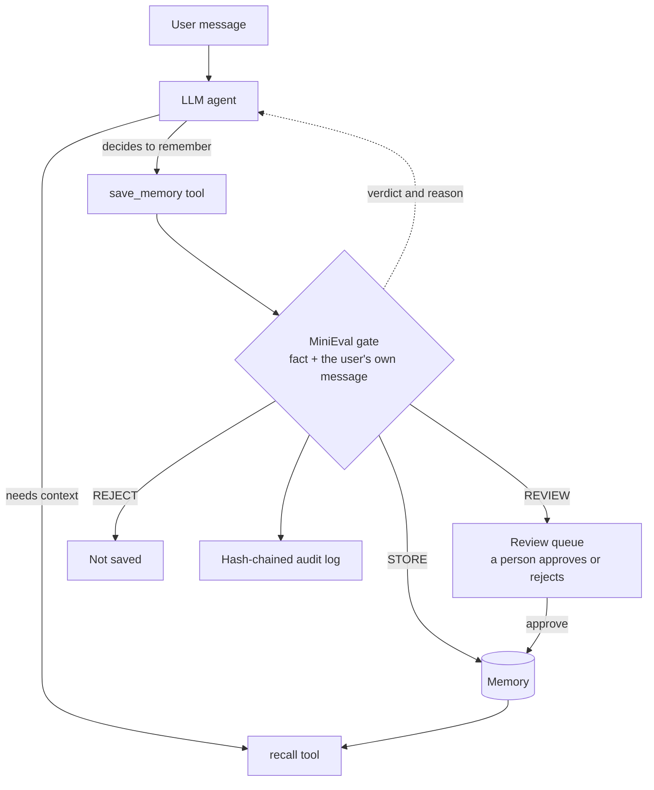

# minieval-agent

A small personal assistant whose long-term memory is guarded by
[MiniEval](https://github.com/DataAlchmesit/MiniEval-pro). The model decides what
to remember; MiniEval decides whether it is allowed in.

Only facts the gate marks STORE are saved. REVIEW goes to a human queue.
Every decision is written to a hash-chained audit log.

## How it works



## Example session

> The `/propose` step simulates a sloppy fact extraction, because a strong model
> usually extracts "the user's brother is a lawyer" correctly on its own.
> Smaller models make the error naturally.

```
PASTE THE REAL OUTPUT OF:  python agent.py --demo
```

## Run
```
pip install minieval-pro openai pytest
# any OpenAI-compatible API (for example Nebius Token Factory; copy the URL and model name from its docs)
export LLM_BASE_URL=...   LLM_API_KEY=...   LLM_MODEL=...      # PowerShell: $env:LLM_BASE_URL="..."
python agent.py --demo     # scripted walkthrough
python agent.py            # chat; /memory /review /approve N /reject N /audit
pytest -q                  # tests (no network, no models needed)
```

## Design choices
- The gate's *source* is always the user's own message. The model never supplies it,
  so it cannot invent evidence for its own claim.
- The tool result tells the model when a save was refused, so it cannot claim to
  remember something that was not stored.
- Tool rounds per message are capped, and model or API errors never crash the chat.
- Review decisions by a person are recorded in the same audit log.

## Output
Notes on this real run (Llama 3.1 8B via Ollama). The model saved only the vegetarian fact and skipped Pune, even though its reply implied both were saved; recall shows what was actually stored. It correctly proposed “The user has a lawyer brother,” and MiniEval still held it for review because its attribution guard fires on “my brother” sentences, a known false positive of a deliberately conservative design. The /propose step then staged a faulty extraction (“The user is a lawyer”), which was held correctly.


## Honest limits
- The demo's `/propose` step is staged (see above).
- MiniEval's known weaknesses still apply, for example some "moved from X to Y" sentences.
- The audit log is tamper-evident, not tamper-proof: someone who recomputes every hash
  can forge a clean chain.
- Memory is a plain JSON file; this is a demo, not a production store.

## License
MIT
